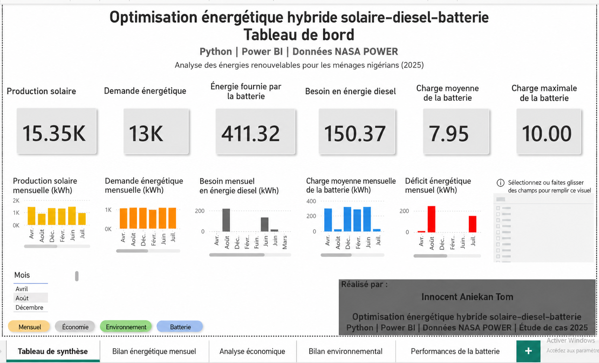
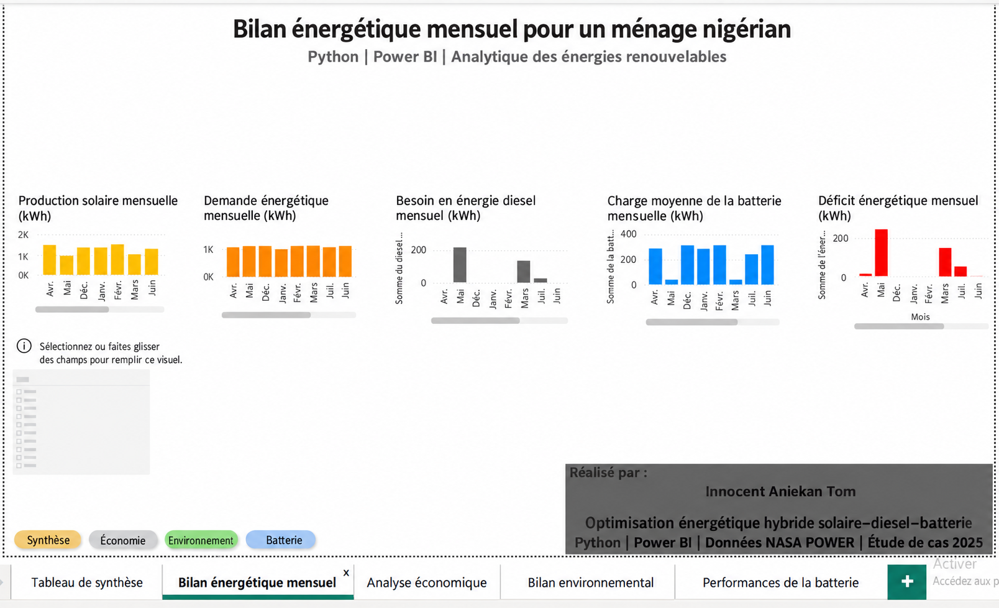
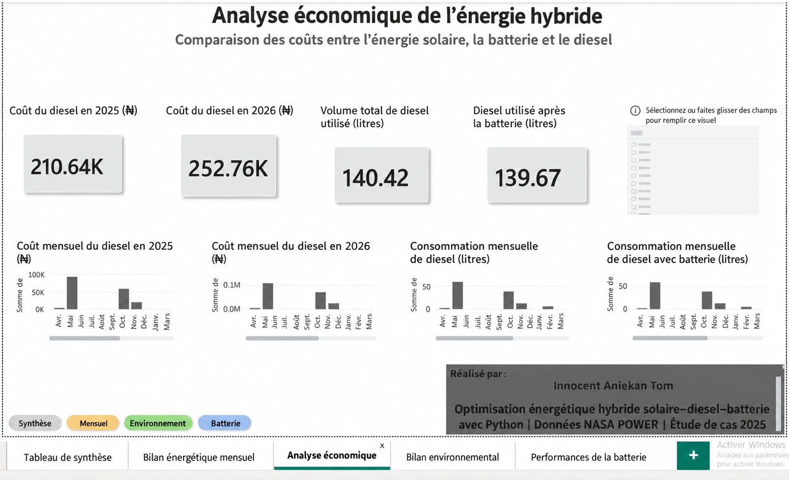
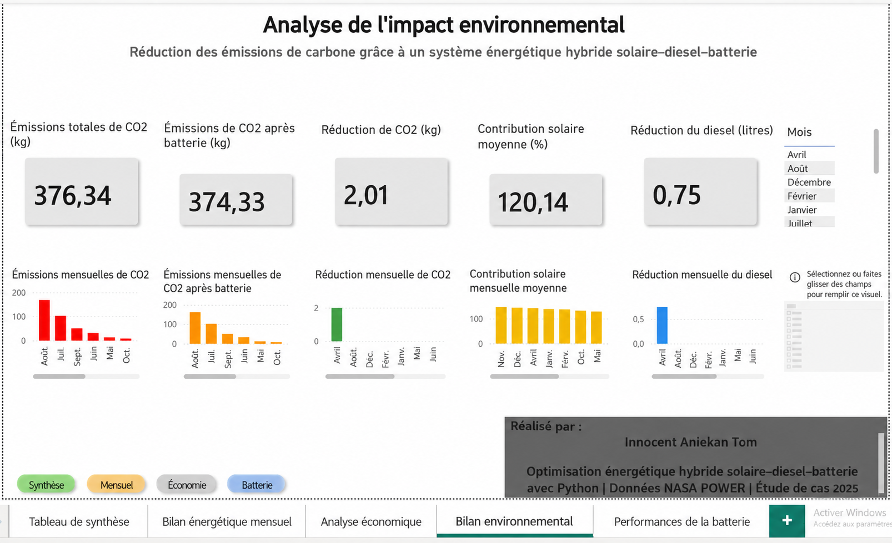
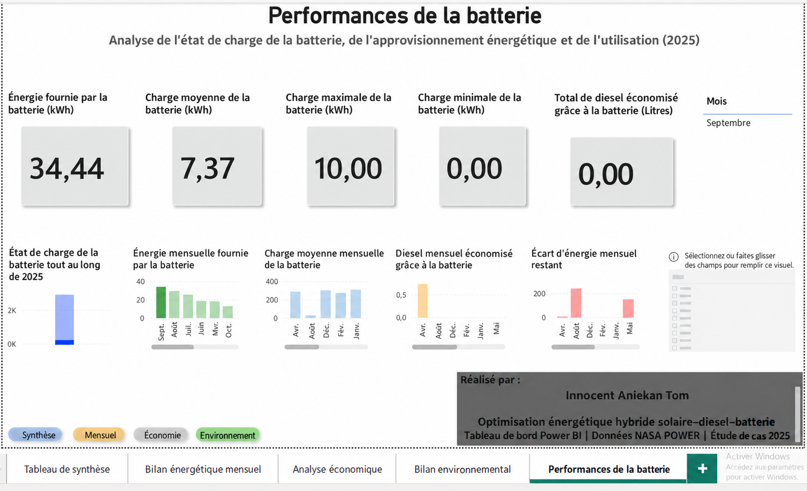

# Optimisation énergétique hybride solaire–diesel–batterie — Tableau de bord pour les ménages nigérians


Projet d'analyse des énergies renouvelables guidé par les données, qui modélise et évalue les performances techniques, économiques et environnementales d'un système hybride associant le photovoltaïque solaire (PV), un groupe électrogène diesel et un stockage d'énergie par batterie, pour l'alimentation électrique résidentielle au Nigeria.

Le projet combine Python pour la modélisation du système énergétique et Power BI pour la visualisation interactive par tableaux de bord, afin de démontrer comment les systèmes hybrides d'énergie renouvelable peuvent réduire la consommation de diesel, diminuer les émissions de carbone, améliorer l'utilisation de la batterie et soutenir une électrification durable des ménages.


## Table des matières

- [Présentation du projet](#présentation-du-projet)
- [Objectifs](#objectifs)
- [Jeu de données](#jeu-de-données)
- [Modèle mathématique](#modèle-mathématique)
- [Aperçu des tableaux de bord](#aperçu-des-tableaux-de-bord)
- [Aperçu visuel des tableaux de bord](#aperçu-visuel-des-tableaux-de-bord)
- [Résultats et discussion](#résultats-et-discussion)
- [Structure du dépôt](#structure-du-dépôt)
- [Guide d'installation](#guide-dinstallation)
- [Améliorations futures](#améliorations-futures)
- [À propos de l'auteur](#à-propos-de-lauteur)
- [Licence](#licence)


## Présentation du projet

L'accès à une électricité fiable reste un défi majeur dans de nombreuses communautés nigérianes, ce qui entraîne une dépendance généralisée aux groupes électrogènes diesel pour l'alimentation résidentielle. Si les groupes électrogènes diesel fournissent une électricité de secours, ils s'accompagnent de coûts d'exploitation élevés, d'une forte volatilité du prix du carburant, d'émissions de gaz à effet de serre et d'une pollution environnementale.

Ce projet étudie l'intégration de la production photovoltaïque solaire (PV), de la production diesel de secours et du stockage d'énergie par batterie au sein d'un système énergétique hybride conçu pour les ménages nigérians. À partir de données d'irradiation solaire issues de la base de données NASA POWER, le système simule la production énergétique quotidienne, la charge et la décharge de la batterie, le fonctionnement du groupe électrogène diesel et la performance globale du système tout au long de l'année.

Les résultats de la simulation sont analysés avec Python et visualisés au moyen d'un tableau de bord Power BI interactif qui présente les indicateurs clés de performance (KPI), les tendances mensuelles, les indicateurs économiques, les bénéfices environnementaux et les performances de la batterie.

Le projet démontre comment l'analyse des énergies renouvelables peut appuyer une prise de décision fondée sur des données probantes pour une planification énergétique durable.


## 🔄 Flux de travail du projet

Le schéma ci-dessous résume le flux de travail suivi pour développer le projet d'optimisation hybride solaire–diesel–batterie.

<p align="center">
  
</p>


## Tableau de bord de synthèse



## Objectifs du projet

L'objectif principal de ce projet est d'évaluer les performances d'un système énergétique hybride solaire PV–diesel–batterie pour l'alimentation électrique résidentielle au Nigeria, au moyen d'une simulation guidée par les données et d'une visualisation interactive.

Les objectifs spécifiques sont les suivants :

- Développer un modèle de système énergétique hybride avec Python.
- Simuler la production quotidienne d'énergie solaire à partir des données d'irradiation solaire NASA POWER.
- Estimer la demande électrique du ménage et la comparer à la production d'énergie renouvelable.
- Modéliser le comportement de charge et de décharge de la batterie tout au long de l'année.
- Déterminer la quantité d'énergie diesel nécessaire pour couvrir la demande électrique non satisfaite.
- Évaluer l'utilisation de la batterie et la fiabilité du système.
- Estimer les bénéfices économiques liés à la réduction de l'usage du groupe électrogène diesel.
- Quantifier les bénéfices environnementaux grâce à la baisse de consommation de diesel et des émissions de CO₂.
- Concevoir un tableau de bord Power BI interactif pour suivre les indicateurs techniques, économiques, environnementaux et de performance de la batterie.


## Questions de recherche

Ce projet cherche à répondre aux questions suivantes :

1. Quelle part de la demande électrique d'un ménage peut être couverte par l'énergie photovoltaïque solaire ?

2. Dans quelle mesure le stockage par batterie peut-il réduire la dépendance aux groupes électrogènes diesel ?

3. Quelles sont les économies annuelles de carburant diesel obtenues grâce à l'intégration d'une batterie ?

4. Quelle quantité d'émissions de dioxyde de carbone (CO₂) peut être évitée grâce à l'adoption d'un système hybride renouvelable ?

5. Quels bénéfices économiques les ménages peuvent-ils tirer d'une réduction de la consommation de diesel ?

6. Comment des tableaux de bord interactifs peuvent-ils améliorer le suivi et l'interprétation des performances d'un système énergétique hybride ?


## Fonctionnalités du projet

Ce projet comprend les fonctionnalités suivantes :

- Simulation de la production photovoltaïque solaire
- Modélisation de l'état de charge (SOC) de la batterie
- Analyse de la charge et de la décharge de la batterie
- Optimisation du groupe électrogène diesel
- Analyse mensuelle de la demande énergétique
- Évaluation du déficit énergétique
- Estimation de la consommation de carburant diesel
- Comparaison des coûts du diesel
- Estimation des émissions de CO₂
- Analyse de la réduction du CO₂
- Évaluation de la contribution de l'énergie solaire
- Analyse de l'utilisation de la batterie
- Tableaux de bord Power BI interactifs
- Tableau de bord de synthèse
- Tableau de bord d'analyse économique
- Tableau de bord d'analyse environnementale
- Tableau de bord des performances de la batterie


## Pile technologique

| Technologie | Usage |
|------------|---------|
| Python | Traitement des données et simulation énergétique hybride |
| Pandas | Nettoyage et manipulation des données |
| NumPy | Calcul numérique |
| Matplotlib | Visualisation des données pendant l'analyse |
| Jupyter Notebook | Développement du modèle et expérimentation |
| Power BI | Développement des tableaux de bord interactifs |
| API NASA POWER | Jeu de données d'irradiation solaire |
| Git | Gestion de versions |
| GitHub | Hébergement du projet et collaboration |


## Architecture du projet

## 🏗 Architecture du système énergétique hybride

La figure ci-dessous illustre l'interaction entre le système photovoltaïque solaire, le stockage par batterie, le groupe électrogène diesel, le modèle de simulation Python et les tableaux de bord Power BI.

<p align="center">
  
</p>


## Jeu de données

L'analyse utilise des données quotidiennes de rayonnement solaire issues de la base de données NASA POWER pour Abuja, au Nigeria.

**Informations sur le jeu de données**

- Source : NASA POWER
- Localisation : Abuja, Nigeria
- Année : 2025
- Résolution temporelle : quotidienne
- Variable principale : ALLSKY_SFC_SW_DWN (irradiance solaire quotidienne)

Les variables supplémentaires générées pendant la simulation comprennent :

- Solar_Output
- Load_kWh
- Battery_SOC
- Battery_Discharge
- Diesel_Liters
- Diesel_Cost_2025
- Diesel_Cost_2026
- Energy_Gap
- Excess_Solar
- Month


## Modèle mathématique

Le système énergétique hybride a été modélisé à l'aide d'une approche de gestion énergétique basée sur des règles, qui donne la priorité à la production photovoltaïque solaire (PV), puis au stockage par batterie, et enfin à la production diesel dès que l'énergie renouvelable est insuffisante pour satisfaire la charge du ménage.

Le modèle suit les étapes suivantes pour chaque jour de la simulation :

1. Estimer la production d'énergie solaire à partir de l'irradiance solaire quotidienne.
2. Comparer l'énergie solaire produite à la demande électrique du ménage.
3. Alimenter la charge directement à partir de l'énergie solaire lorsqu'elle est disponible.
4. Stocker l'excédent d'énergie solaire dans la batterie jusqu'à ce qu'elle atteigne sa capacité maximale.
5. Lorsque l'énergie solaire est insuffisante, décharger la batterie pour fournir le reste de la charge.
6. Si la batterie est épuisée, utiliser le groupe électrogène diesel pour satisfaire la demande électrique restante.

Les équations suivantes ont été appliquées lors de la simulation.

### Production d'énergie solaire

Production solaire = Irradiance solaire × Taille du système × Rendement du système

### Déficit énergétique

Déficit énergétique = Charge − Production solaire

### Charge de la batterie

SOC batterie = SOC précédent + Excédent solaire

où le SOC de la batterie ne peut pas dépasser la capacité de la batterie.

### Décharge de la batterie

Décharge batterie = Minimum (SOC batterie, Déficit énergétique)

### Besoin en énergie diesel

Diesel requis = Maximum (Déficit énergétique − Décharge batterie, 0)

Cette stratégie séquentielle de gestion énergétique minimise le fonctionnement du groupe électrogène diesel tout en maximisant l'utilisation de l'énergie renouvelable et du stockage par batterie.


## Aperçu des tableaux de bord

Les résultats de la simulation ont été visualisés avec Microsoft Power BI au moyen d'un tableau de bord interactif composé de quatre pages d'analyse.

### Tableau de bord de synthèse

Fournit une synthèse de haut niveau du système énergétique hybride à l'aide d'indicateurs clés de performance (KPI), de tendances mensuelles et de filtres interactifs.

Les indicateurs clés comprennent :

- Production solaire
- Demande énergétique
- Production de la batterie
- Production diesel
- Diesel requis
- SOC moyen de la batterie
- SOC maximal de la batterie


### Tableau de bord économique

Évalue la performance financière du système énergétique hybride à travers :

- Coût du diesel
- Coût d'investissement de la batterie
- Économies réalisées
- Analyse du retour sur investissement


### Tableau de bord environnemental

Mesure la durabilité environnementale à l'aide de :

- Émissions de CO₂
- Réduction du CO₂
- Contribution de l'énergie solaire
- Réduction du diesel


### Tableau de bord des performances de la batterie

Suit le comportement de la batterie tout au long de la période de simulation, notamment :

- État de charge (SOC) de la batterie
- Charge de la batterie
- Décharge de la batterie
- Utilisation de la batterie
- Déficit énergétique restant


## Aperçu visuel des tableaux de bord

Les tableaux de bord suivants ont été développés dans **Microsoft Power BI** afin de fournir une visualisation interactive du système énergétique hybride solaire–diesel–batterie.

### Tableau de bord de synthèse


---

### Tableau de bord énergétique mensuel



---

### Tableau de bord économique



---

### Tableau de bord environnemental



---

### Tableau de bord des performances de la batterie




## Résultats et discussion

La simulation démontre l'efficacité de l'intégration de la production photovoltaïque solaire avec un stockage par batterie pour réduire la dépendance aux groupes électrogènes diesel dans l'alimentation électrique résidentielle.

Les principaux résultats sont les suivants :

- Le solaire PV a couvert la majeure partie de la demande énergétique annuelle du ménage.
- La batterie a permis de stocker l'excédent d'énergie solaire pendant les périodes de forte production et de fournir de l'électricité pendant les périodes de production solaire insuffisante.
- L'usage du groupe électrogène diesel a nettement diminué après l'intégration de la batterie.
- L'augmentation de la capacité de la batterie a réduit les besoins en énergie diesel, bien que le taux d'amélioration ait diminué pour les capacités plus élevées.
- L'analyse environnementale a montré une réduction des émissions de dioxyde de carbone (CO₂) liées au diesel.
- L'analyse économique a indiqué que, si les batteries plus grandes exigent un investissement initial plus élevé, elles contribuent à des réductions durables des coûts d'exploitation du diesel.

Le tableau de bord Power BI interactif offre aux décideurs une plateforme intuitive pour suivre les performances techniques, les bénéfices économiques et les impacts environnementaux des systèmes hybrides d'énergie renouvelable.


## Structure du dépôt

```text
Hybrid-Solar-Diesel-Battery-Optimization/

├── Data/                  # Jeux de données d'entrée et traités
├── notebooks/             # Analyse sous Jupyter Notebook
├── scripts/               # Scripts Python
├── powerbi/               # Tableau de bord Power BI
├── outputs/               # Résultats de la simulation
├── images/                # Captures d'écran des tableaux de bord
├── docs/                  # Documentation du projet
├── README.md
├── requirements.txt
└── LICENSE
```


## Guide d'installation

Cloner le dépôt :

```bash
git clone https://github.com/Innocentaniekan/Hybrid-Solar-Diesel-Battery-Optimization.git
```

Se placer dans le dossier du projet :

```bash
cd Hybrid-Solar-Diesel-Battery-Optimization
```

Installer les bibliothèques Python requises :

```bash
pip install -r requirements.txt
```

Ouvrir le Jupyter Notebook :

```bash
jupyter notebook
```

Lancer le notebook situé dans le dossier `notebooks` et exécuter les cellules dans l'ordre pour reproduire l'analyse.

Le tableau de bord Power BI peut être ouvert avec Microsoft Power BI Desktop.


## Améliorations futures

Les améliorations futures envisageables comprennent :

- Intégration de données météorologiques en temps réel.
- Modèles d'apprentissage automatique pour la prévision de l'énergie solaire.
- Prévision de la demande électrique à partir de données de consommation historiques.
- Modélisation de la dégradation de la batterie.
- Optimisation multi-objectifs du coût, de la fiabilité et des émissions.
- Déploiement du tableau de bord sur le Web.
- Intégration à des systèmes énergétiques intelligents compatibles IoT.


## À propos de l'auteur

**Innocent Aniekan**

Technologue en génie mécanique, intéressé par les systèmes d'énergie renouvelable, les systèmes d'alimentation hybrides, l'analyse énergétique, la visualisation de données et le développement durable.

Ce projet démontre une expérience pratique en :

- Programmation Python
- Analyse de données
- Modélisation des énergies renouvelables
- Systèmes de stockage d'énergie par batterie
- Développement de tableaux de bord Power BI
- Git et GitHub


## Licence

Ce projet est distribué sous licence MIT.

Voir le fichier LICENSE pour plus d'informations.
