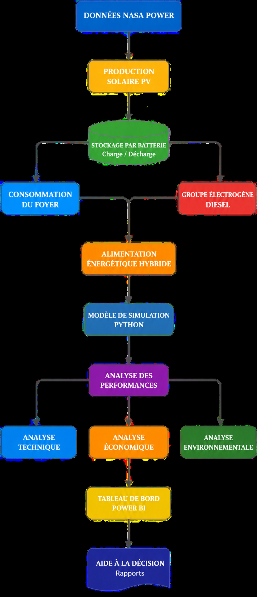
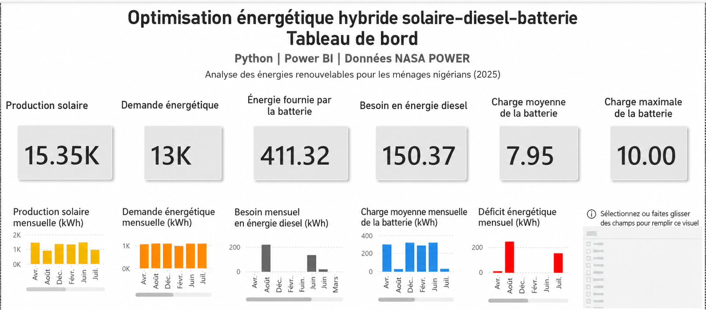
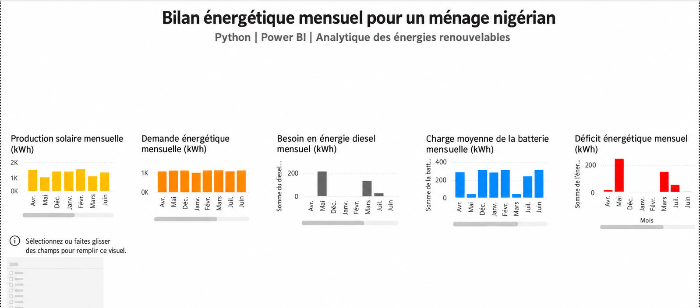
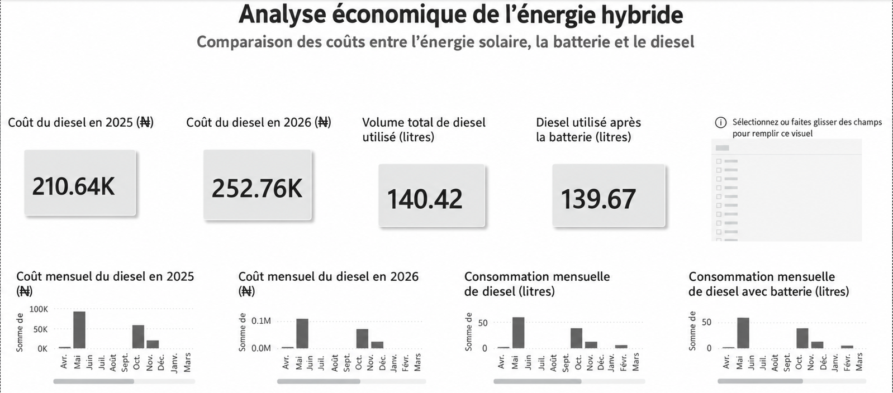
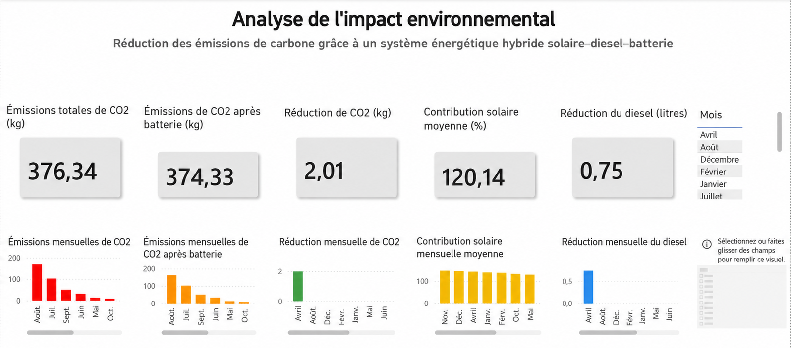
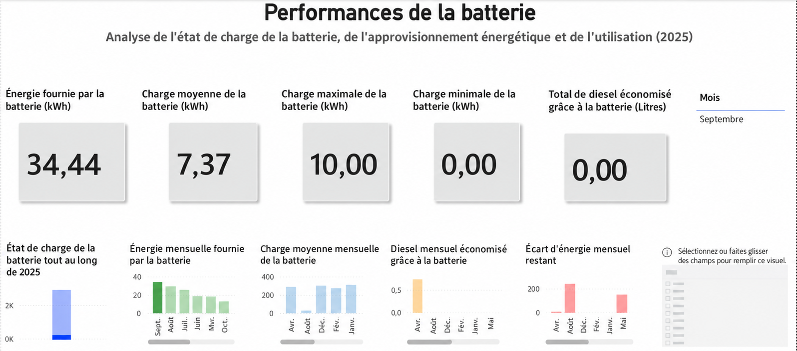

#  Simulation d'un système hybride solaire–diesel–batterie

### Modélisation énergétique | Photovoltaïque | Stockage par batterie | Analyse technico-économique

**Projet d'ingénierie — ECAM-EPMI | Spécialité ISE (Ingénieur en Système Électrique)**

**Équipe :** Moustapha IBRAHIM DJAMA · Thomas DHUNARA · Mariel FRESNEL

[](https://www.python.org/)


[🌐 Portfolio de Moustapha](https://portfolio-eta-ten-t34s52rvq8.vercel.app/)

---

##  Présentation du projet

L'intégration des énergies renouvelables dans les systèmes électriques constitue un enjeu important pour améliorer la disponibilité de l'énergie et réduire la dépendance aux combustibles fossiles.

Ce projet porte sur l'étude d'un **système énergétique hybride associant une installation photovoltaïque, un stockage par batterie et un groupe électrogène diesel**.

Le cas d'étude concerne l'alimentation électrique d'un ménage situé à **Abuja, au Nigeria**, à partir de données d'ensoleillement couvrant l'année 2025.

L'objectif est d'analyser la complémentarité des différentes sources d'énergie et d'étudier leur contribution à la satisfaction de la demande électrique.

L'étude s'articule autour de plusieurs axes :

- Exploitation de données météorologiques réelles.
- Estimation de la production photovoltaïque.
- Analyse de l'adéquation entre production et consommation.
- Étude du rôle du stockage dans la gestion des déficits énergétiques.
- Analyse de l'utilisation du groupe électrogène en complément du solaire.
- Exploration des performances énergétiques, économiques et environnementales à partir des résultats disponibles.
- Visualisation des indicateurs à l'aide de Python et Power BI.

Ce travail permet de relier les connaissances en systèmes électriques, énergies renouvelables, stockage et analyse de données.

---

## ⚡ Architecture du système hybride

Le système étudié associe trois composants énergétiques complémentaires.

| Composant | Fonction principale |
|---|---|
| Panneaux photovoltaïques | Production d'électricité à partir du rayonnement solaire |
| Batterie | Stockage des excédents et restitution d'énergie |
| Groupe électrogène diesel | Production complémentaire lorsque les ressources renouvelables sont insuffisantes |
| Charge électrique | Consommation du ménage |
| Système de gestion énergétique | Répartition de l'énergie entre production, stockage et consommation |

### Schéma de principe



### Stratégie de gestion énergétique

Le fonctionnement du système repose sur une priorité donnée à l'énergie solaire.

**1. Production photovoltaïque**

L'énergie produite par les panneaux solaires est utilisée en priorité pour alimenter la consommation du ménage.

**2. Stockage de l'excédent**

Lorsque la production solaire dépasse les besoins, l'énergie excédentaire peut être stockée dans la batterie, dans la limite de sa capacité disponible.

**3. Décharge de la batterie**

En cas de production photovoltaïque insuffisante, la batterie peut fournir une partie de l'énergie nécessaire.

**4. Production diesel**

Le groupe électrogène constitue une source d'appoint lorsque le solaire et l'énergie disponible dans la batterie ne suffisent plus à couvrir la demande.

Cette stratégie vise à favoriser l'autoconsommation photovoltaïque et à limiter le recours au groupe électrogène.

---

## Zone d'étude et données utilisées

### Localisation : Abuja, Nigeria

Abuja présente un contexte intéressant pour l'étude de solutions photovoltaïques hybrides en raison de son potentiel solaire et des enjeux liés à la continuité de l'approvisionnement électrique.

Les données météorologiques exploitées proviennent de la plateforme **NASA POWER**, qui fournit des séries climatiques et solaires adaptées aux études énergétiques.

**Source :** [NASA POWER – Prediction Of Worldwide Energy Resources](https://power.larc.nasa.gov/)

### Paramètres de simulation

| Paramètre | Valeur |
|---|---|
| Localisation | Abuja, Nigeria |
| Période étudiée | 01/01/2025 au 31/12/2025 |
| Résolution temporelle | Journalière |
| Source météorologique | NASA POWER |
| Indicateur solaire | `ALLSKY_SFC_SW_DWN` |
| Puissance photovoltaïque nominale | 8 kW |
| Demande électrique journalière | 35 kWh/jour |
| Énergie maximale stockée observée dans les résultats | 10 kWh |
| Sources énergétiques | Solaire, batterie et diesel |

Les valeurs de 8 kW et 35 kWh/jour correspondent au scénario représenté dans le fichier de résultats de référence.

La valeur de 10 kWh provient de l'état de stockage observé et ne constitue pas, à elle seule, une justification de la capacité nominale de la batterie.

### Organisation du traitement des données


---

##  Modélisation et calculs énergétiques

La modélisation permet d'étudier l'évolution de la production solaire et son adéquation avec la consommation électrique.

Le carnet Python présent dans ce dépôt traite les premières étapes de cette analyse.

### 1. Estimation de la production photovoltaïque

La production journalière simplifiée est estimée à partir de l'ensoleillement et de la puissance nominale de l'installation :

$$
E_{PV,j} \approx H_j \times P_{PV}
$$

Avec :

- **E_PV,j** : énergie photovoltaïque journalière (kWh).
- **H_j** : irradiation quotidienne exprimée en heures de soleil équivalentes (h).
- **P_PV** : puissance photovoltaïque nominale (kW).

L'irradiation fournie en kWh/m²/jour est convertie en heures équivalentes en la rapportant à l'irradiance de référence de 1 kW/m².

Cette première approximation néglige les pertes électriques et thermiques.

Une estimation plus représentative des conditions réelles peut intégrer un ratio de performance :

$$
E_{PV,j} = H_j \times P_{PV} \times PR
$$

où **PR** représente le ratio de performance global de l'installation.

### 2. Analyse de la demande électrique

La demande électrique journalière retenue dans le scénario est de :

$$
E_{charge} = 35\ \text{kWh/jour}
$$

Cette hypothèse permet de comparer les besoins du ménage à la production photovoltaïque estimée pour chaque journée.

### 3. Calcul du déficit énergétique

Lorsque la production solaire est inférieure à la demande, un déficit apparaît :

$$
E_{déficit} = \max(E_{charge} - E_{PV}, 0)
$$

Ce déficit représente l'énergie restant à fournir par les autres composants du système.

Il ne correspond pas directement à la production diesel : une partie peut être couverte par la batterie.

### 4. Gestion du stockage

La batterie intervient pour absorber une partie des excédents photovoltaïques et restituer de l'énergie lorsque la production devient insuffisante.

Son fonctionnement dépend notamment :

- De l'énergie stockée disponible.
- De la capacité nominale.
- Des rendements de charge et de décharge.
- Des limites de puissance.
- Des seuils minimaux et maximaux de fonctionnement.

L'analyse du stockage permet d'étudier sa contribution à la continuité de l'alimentation et à la réduction du recours au groupe électrogène.

### 5. Contribution du groupe électrogène diesel

Le groupe diesel assure une production complémentaire lorsque les ressources solaire et batterie ne permettent pas de satisfaire la charge.

Son fonctionnement peut être analysé à travers :

- L'énergie électrique fournie.
- La durée de fonctionnement.
- La consommation de carburant.
- Le coût d'exploitation.
- Les émissions de CO₂ associées.

Ces indicateurs sont présents dans le jeu de résultats utilisé pour l'analyse. Leur recalcul intégral nécessite des paramètres complémentaires de fonctionnement du groupe.

---

##  Analyse et visualisation des résultats

Les données de simulation sont exploitées au travers de plusieurs représentations permettant d'étudier les performances du système.

Les tableaux de bord présentés ci-dessous proviennent du dossier de référence utilisé pour l'étude. Ils servent de support à l'interprétation et à la comparaison des indicateurs énergétiques.

### 1. Tableau de bord général



Cette vue regroupe les principaux indicateurs du système hybride et facilite la lecture de son fonctionnement global.

Elle permet notamment d'observer la répartition des contributions énergétiques et les performances associées au scénario étudié.

### 2. Bilan énergétique mensuel



L'analyse mensuelle permet d'étudier l'évolution de la production solaire et de la demande au cours de l'année.

Elle met en évidence l'influence des variations saisonnières d'ensoleillement sur l'équilibre énergétique du système.

### 3. Analyse économique



L'étude économique s'intéresse aux indicateurs relatifs au fonctionnement des différentes sources d'énergie.

Elle permet d'examiner les coûts associés au recours au diesel et les économies potentielles liées à l'utilisation de l'énergie solaire et du stockage.

Les valeurs économiques doivent être interprétées en fonction des hypothèses de prix et de consommation utilisées dans le scénario de référence.

### 4. Analyse environnementale



Cette analyse porte sur les émissions de CO₂ associées à l'utilisation du groupe électrogène diesel.

L'intégration du solaire et du stockage peut contribuer à réduire le fonctionnement du groupe et, par conséquent, les émissions directes liées à la combustion du carburant.

### 5. Performances du stockage



Le suivi énergétique de la batterie permet d'étudier les périodes de charge et de décharge et la contribution du stockage à l'alimentation du ménage.

L'analyse de ces données aide à comprendre l'intérêt d'une gestion coordonnée entre production solaire, stockage et groupe diesel.

---

##  Outils et technologies

| Outil | Utilisation |
|---|---|
| **Python** | Traitement des données et calculs énergétiques |
| **Pandas** | Importation, organisation et comparaison des données |
| **NumPy** | Calcul numérique |
| **Matplotlib** | Bibliothèque disponible pour les représentations graphiques |
| **Jupyter Notebook** | Exécution et documentation des calculs |
| **Power BI** | Exploration et visualisation des résultats du modèle de référence |
| **CSV** | Stockage et échange des séries de données |
| **GitHub** | Organisation et partage du projet |

---

## Structure du dépôt

```text
simulation-stockage-energie-renouvelable/
│
├── README.md
├── dependances.txt
│
├── donnees/
│   └── ensoleillement_abuja_2025.csv
│
├── calculs/
│   └── modele_solaire_diesel_batterie.ipynb
│
├── resultats/
│   └── simulation_systeme_hybride.csv
│
├── tableaux_de_bord/
│   └── tableau_de_bord_systeme_hybride.pbix
│
└── illustrations/
    ├── 01_organisation_de_l_etude.png
    ├── 02_architecture_systeme_hybride.png
    ├── 03_tableau_bord_synthese.png
    ├── 04_bilan_energetique_mensuel.png
    ├── 05_analyse_economique.png
    ├── 06_bilan_environnemental.png
    └── 07_performances_batterie.png
```

### Description des principaux fichiers

| Fichier | Contenu |
|---|---|
| `ensoleillement_abuja_2025.csv` | Données solaires journalières pour Abuja |
| `modele_solaire_diesel_batterie.ipynb` | Calculs Python de production photovoltaïque et de déficit |
| `simulation_systeme_hybride.csv` | Résultats énergétiques du scénario de référence |
| `tableau_de_bord_systeme_hybride.pbix` | Tableau de bord Power BI |
| `illustrations/` | Schémas et visualisations du système |

---

##  Exécution du projet

### Prérequis

- Python 3
- Jupyter Notebook
- Power BI Desktop pour consulter le tableau de bord

### 1. Cloner le dépôt

```bash
git clone https://github.com/Moustaled/simulation-stockage-energie-renouvelable.git

cd simulation-stockage-energie-renouvelable
```

### 2. Installer les dépendances

```bash
python -m pip install -r dependances.txt
```

### 3. Lancer le carnet de calcul

```bash
jupyter notebook calculs/modele_solaire_diesel_batterie.ipynb
```

Le carnet permet notamment :

1. D'importer les données d'ensoleillement NASA POWER.
2. De calculer la production photovoltaïque simplifiée.
3. De représenter la demande électrique journalière dans les données.
4. De déterminer les déficits énergétiques.
5. De comparer les premières grandeurs calculées au fichier de référence.

### 4. Consulter le tableau de bord Power BI

Ouvrir le fichier :

`tableaux_de_bord/tableau_de_bord_systeme_hybride.pbix`

Si nécessaire, actualiser le chemin de la source de données vers :

`resultats/simulation_systeme_hybride.csv`

---

##  Périmètre de l'analyse

Le projet réunit un carnet de calcul Python, des données météorologiques et un jeu de résultats accompagné de tableaux de bord de référence.

Le modèle Python disponible permet de recalculer la production solaire simplifiée et le déficit énergétique journalier. Les résultats détaillés relatifs au stockage, au diesel, aux coûts et aux émissions proviennent du fichier de simulation de référence.

Leur interprétation nécessite de tenir compte des hypothèses retenues, notamment des rendements, de la capacité de stockage, des caractéristiques du groupe électrogène et des prix du carburant.

Cette distinction assure la traçabilité des calculs et des résultats utilisés dans l'étude.

---

##  Intérêt du projet

Ce cas d'étude illustre plusieurs problématiques rencontrées dans la conception et l'exploitation des systèmes énergétiques hybrides :

- La variabilité de la production renouvelable.
- L'adéquation entre production et consommation.
- Le dimensionnement des moyens de stockage.
- La complémentarité entre ressources renouvelables et production conventionnelle.
- L'influence du stockage sur le recours au groupe diesel.
- L'analyse des performances énergétiques et environnementales.
- L'exploitation des données pour l'aide à la décision.

Il constitue une application des compétences développées en **systèmes électriques, énergies renouvelables, gestion de l'énergie et analyse de données**.

---

##  Équipe du projet

**Moustapha IBRAHIM DJAMA**  
Élève-ingénieur — ECAM-EPMI  
Spécialité ISE (Ingénieur en Système Électrique)  
🌐 [Portfolio personnel](https://portfolio-eta-ten-t34s52rvq8.vercel.app/)

**Thomas DHUNARA**  
Élève-ingénieur — ECAM-EPMI

**Mariel FRESNEL**  
Élève-ingénieur — ECAM-EPMI

---

**ECAM-EPMI | Projet académique — Systèmes électriques et énergies renouvelables**
